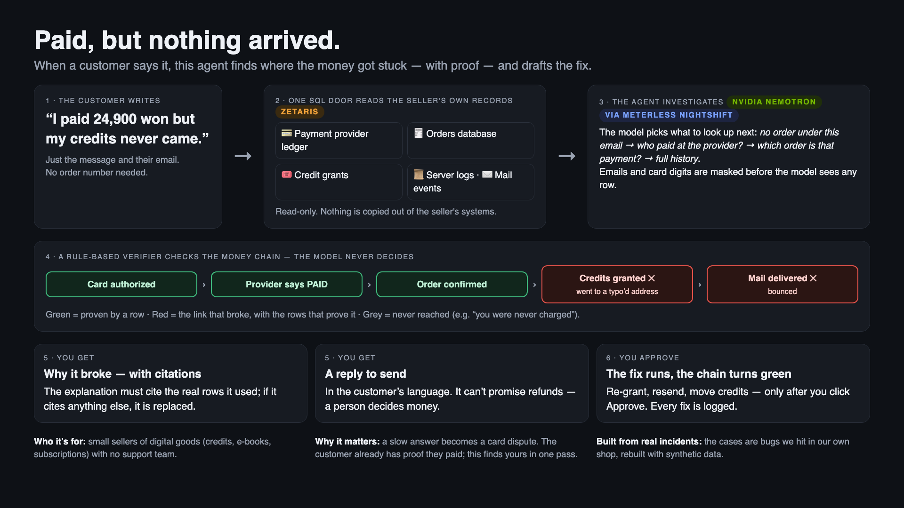
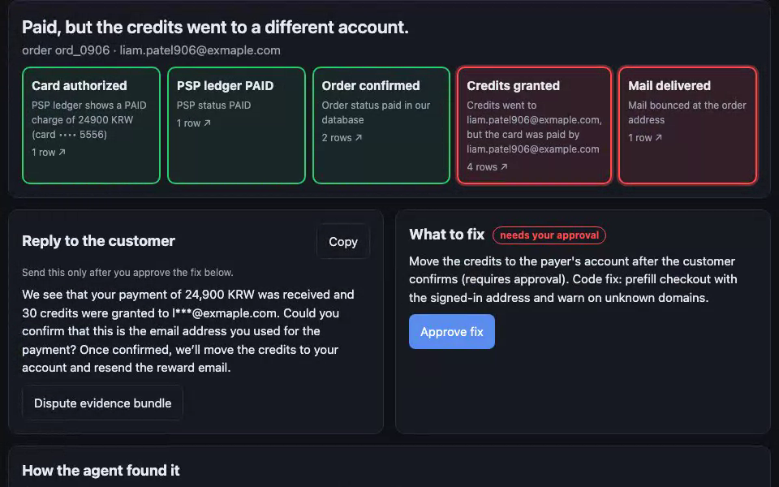
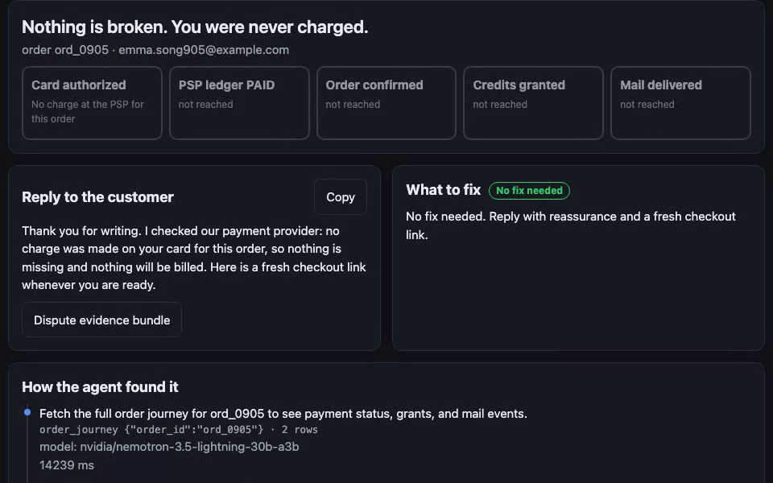

# Paid, but nothing arrived
## The agent that finds the broken link

Track 02 — The Agent That Can Explain Why · Team MoaHub (solo)

> Your customer already has proof they paid. This agent finds yours.

---

# How it works, in one picture

---

# The problem, the user

- Who: a one-person or small online seller of digital goods, credits, subscriptions. No support team.
- The message: **"I paid, but nothing arrived."**
- Slow answer → card dispute, *product not received*. The customer holds the proof (card SMS). The seller has to find theirs.

---

# Today: four screens, by hand

PSP dashboard · orders database · server logs · mail provider

Same question asked four times, lined up by eye. We did this ourselves while auditing our own checkout.

---

# The solution: one chain, one broken link

`card authorized → PSP paid → order confirmed → credits granted → mail delivered`

Green until the link that broke. Click the link → the raw row that proves it. Then: reply draft · fix (needs approval) · dispute evidence bundle.

---

# Agent workflow

1. locate the order (email / order id)
2. `order_journey` — read-only SQL to Zetaris across the five tables of one semantic layer
3. deterministic verifier: each link green / red / grey, with refs
4. Nemotron (via Nightshift) explains and drafts the reply; the fix comes from the verifier
5. citation check: the explanation must cite returned `ref`s and may cite nothing else, or it is replaced by the verifier's text

---

# Technical stack

Python 3.12 · FastAPI · Zetaris (Lightning JDBC, USL) · Meterless Nightshift · NVIDIA Nemotron 3.5 Lightning · DuckDB (tests) · Cursor

---

# How Zetaris was used

- Five synthetic tables in one Postgres datasource (`demo_pg`), activated into the semantic layer `order_journey`, related on `order_id` / `payment_id` / `email`.
- The agent sends SQL only. Nothing is copied. Every row carries `table:key`.
- Same SQL on DuckDB for tests; backend name printed on every result.

---

# How Meterless + NVIDIA were used

- Every model call goes through Nightshift on the Mac: a Nemotron lane (NVIDIA's hosted endpoint in the demo), a receipt for every answer. Addresses are masked and card digits removed before the model sees rows.
- Nemotron explains and drafts; it never decides the verdict.
- Measured on the final code through Nightshift → Nemotron (hosted): right order and link 6/6, citation check 6/6, loop named the order 5/6, cross-customer probe blocked; 18 automated tests.

---

# Product

Case 6, live through Zetaris: paid with one address, the order was saved under a typo (exmaple.com). Two red links, each with the rows that prove it; the reply asks the customer to confirm, the fix waits for approval.

---

# Product — when nothing is broken

Case 5: grey chain, "You were never charged." The message also quoted another customer's order (ord_0903): not read, and the page says so. All data synthetic.

---

# What's next

- Real PSP connectors (Stripe, PortOne) and mail providers as Zetaris REST sources
- Screenshot reading (receipt / card SMS) with a local vision model
- Installable edition for sellers; Korean UI
- Cursor: project rules in .cursor/rules
